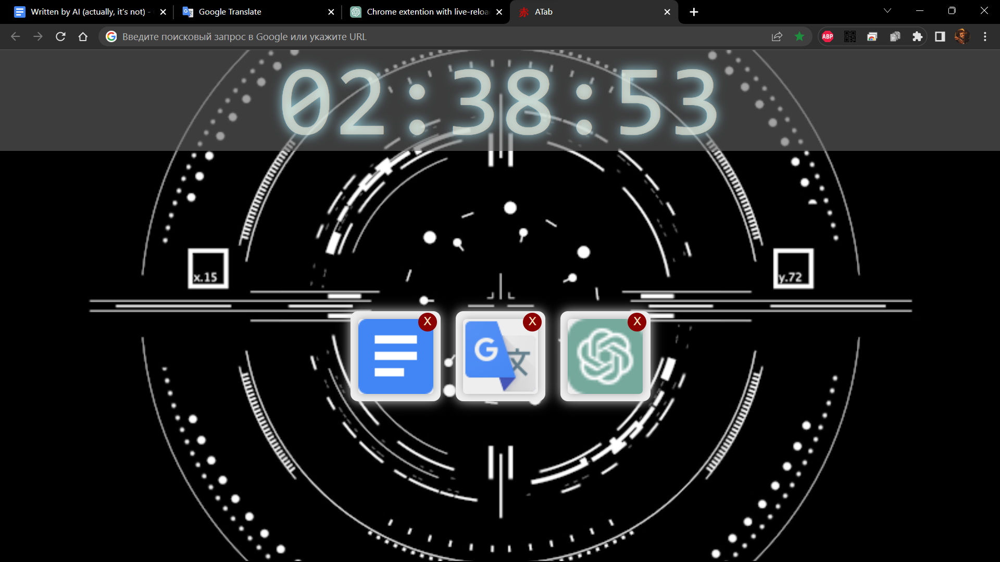

# Awesome Tab (ATab)

Awesome Tab is a Chrome Extension that replaces the New Tab page, providing a clean interface for managing tabs and bookmarks. Designed for power users who value speed, keyboard accessibility, and a clutter-free environment.

[Home Page / Demo](https://a13ks3y.github.io/ATab/)


*(Note: Screenshot above may be outdated. See project description below for current features.)*

## Key Features

- **Clean Interface**: Replaces the default New Tab page with a minimalist design.
- **Tab Management**: 
  - Quickly view and navigate open tabs.
  - "Close others" button to tidy up your workspace.
  - Close stale tabs automatically or manually.
  - Save and restore tab sessions (Snapshots).
- **Productivity Tools**:
  - **Pomodoro Timer**: Customizable work/break intervals.
  - **Zen Mode**: Hide distractions (bookmarks, widgets).
  - **Quick Notes**: Persistent notepad.
  - **Weather**: Local weather conditions.
  - **Analytics**: Visualize your tab usage and focus time.
- **Reading List**: Integrated sidebar for your reading list.
- **Bookmarks & Folders**:
  - Full access to your bookmarks hierarchy.
  - Easy navigation through bookmark folders.
- **Keyboard Navigation**:
  - Full keyboard support for tabs, menus, and widgets.
  - Accessible ARIA labels and focus management.
- **Customization**:
  - Dark/Light mode.
  - Custom background image uploads.
  - Grid density settings.
  - Cloud sync for settings.
  - Full support for Arrow keys (Up/Down/Left/Right) to navigate tabs and bookmarks.
  - `Tab`/`Shift+Tab` support.
  - `Enter` to open selected tab or bookmark.
- **Performance**: Lightweight Vanilla JS implementation (no heavy frameworks).

## Installation

### From Chrome Web Store
[Download from Chrome Web Store](https://chrome.google.com/webstore/detail/atab/hffgbimhegfljiohccdgeneejdcpdgid)

### Manual Installation (Development)

1. **Clone the repository**:
   ```bash
   git clone https://github.com/a13ks3y/ATab.git
   cd ATab
   ```

2. **Install dependencies**:
   ```bash
   npm install --legacy-peer-deps
   ```

3. **Build the project**:
   ```bash
   npm run build
   ```
   This will generate a `dist` folder.

4. **Load in Chrome**:
   - Open Chrome and navigate to `chrome://extensions/`.
   - Enable **Developer mode** (top right).
   - Click **Load unpacked**.
   - Select the `dist` folder from the project directory.

## Development

- **Start (Dev Server)**: `npm start`
- **Watch Mode**: `npm run watch` (Rebuilds on file changes)
- **Test**: `npm test` (Runs Jest tests)

## Project Description (For Store Update)

*Use the following description when updating screenshots and video on the Web Store:*

**Awesome Tab - The Fast, Keyboard-Friendly New Tab Page**

Transform your New Tab page into a productivity powerhouse. Awesome Tab (ATab) gives you instant access to your open tabs and bookmarks in a clean, organized layout.

**What's New in Version 2.4:**
- **Enhanced Keyboard Navigation**: Navigate effortlessly through multi-row tab layouts using Arrow keys.
- **Improved Bookmarks**: Smoother folder navigation and mouse interactions.
- **Visual Polish**: New UI animations for closing tabs and refined focus states.

**Visual Highlights (for Screenshots):**
1. **Clean Start**: Show the minimalist opening screen with the list of current open tabs.
2. **Keyboard Focus**: Highlight the visual feedback when using keyboard navigation (focused tabs/bookmarks).
3. **Bookmarks**: Display the open bookmarks folder view to demonstrate hierarchy support.

## Roadmap & Progress

See [PRD.md](./PRD.md) for the detailed project roadmap and progress log.

## License

MIT
